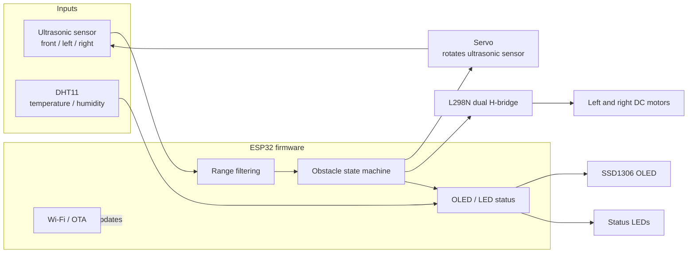
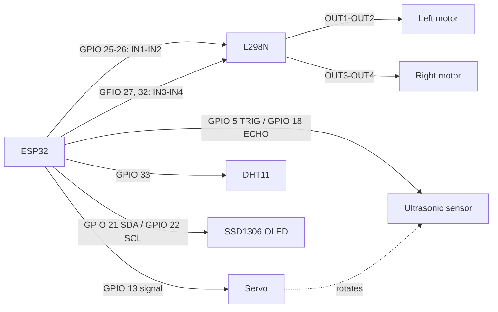
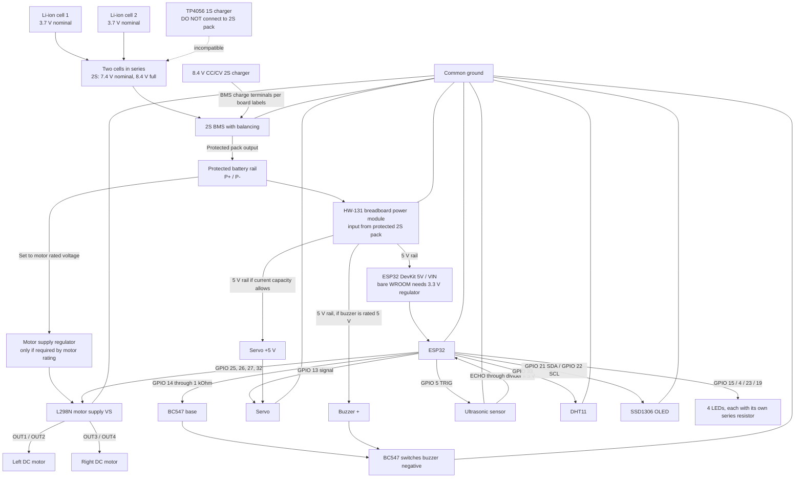
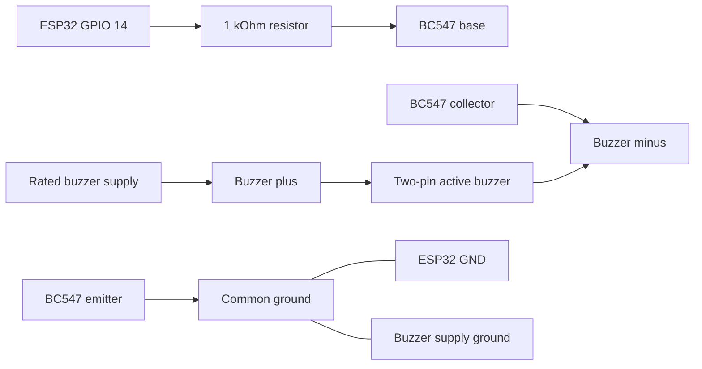
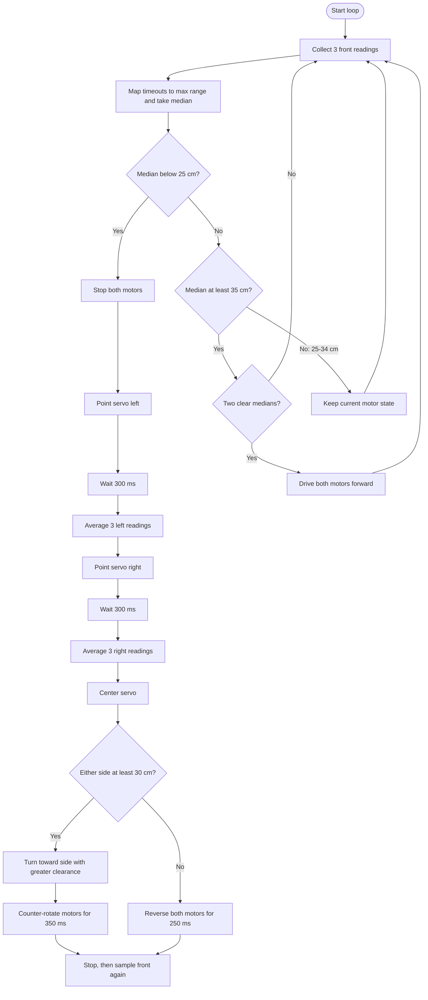
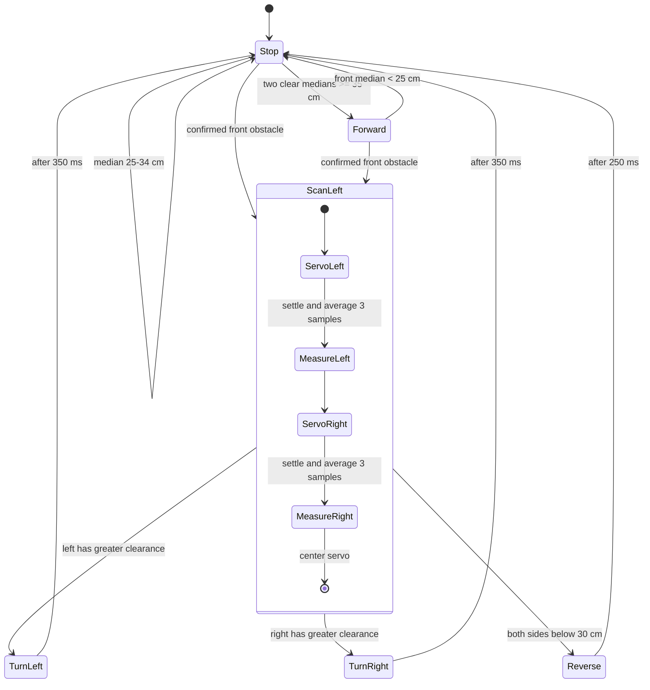

# ESP32 Obstacle-Avoiding Boat

Firmware for an ESP32 boat using an L298N dual H-bridge, two DC motors, a servo-mounted ultrasonic sensor, an OLED, and a DHT11. The controller samples the front range, scans both sides when an obstacle is close, and chooses a short turn or reverse action.

## System Block Diagram



## Wiring Map

| Device signal | ESP32 GPIO | Connection |
| --- | ---: | --- |
| L298N IN1 | 25 | Left motor direction input 1 |
| L298N IN2 | 26 | Left motor direction input 2 |
| L298N IN3 | 27 | Right motor direction input 1 |
| L298N IN4 | 32 | Right motor direction input 2 |
| Buzzer driver control | 14 | Drives BC547 base through a 1 kOhm resistor |
| Ultrasonic TRIG | 5 | Trigger input |
| Ultrasonic ECHO | 18 | Echo output, through a 5 V-to-3.3 V level divider when required |
| Servo signal | 13 | Sensor scanning servo |
| DHT11 data | 33 | Temperature/humidity data |
| OLED SDA | 21 | I2C data |
| OLED SCL | 22 | I2C clock |
| Stop LED | 15 | Red status LED |
| Forward/turn LED | 4 | Green status LED |
| Reverse LED | 23 | Blue status LED |
| Heartbeat LED | 19 | Green heartbeat |
| OTA LED | 2 | ESP32 onboard LED |



The firmware assumes the L298N `ENA` and `ENB` jumpers are installed, so both channels run at full speed. Use a suitable motor supply and servo supply; connect their grounds to ESP32 ground. Do not power motors from the ESP32 3.3 V pin. Confirm the ultrasonic ECHO voltage is safe for the ESP32 before connecting it.

## Power and Full Wiring Schematic

**Do not connect the series pair of 3.7 V cells to a TP4056.** The two series cells form a 2S lithium-ion pack (7.4 V nominal, 8.4 V fully charged), while a TP4056 is for one cell (1S). For this series pack, use a 2S BMS with balancing and a compatible 8.4 V CC/CV 2S charger. The BMS is not itself a charger.



The HW-131 shown is the common breadboard supply module with selectable 5 V/3.3 V rails; verify the labels and input range on your exact board. A 2S pack ranges from about 6.0 V to 8.4 V, while many HW-131/MB102 versions specify a 6.5 V minimum input. Connect the pack directly only if your module accepts the entire pack voltage range; otherwise use a suitable input DC/DC converter. Select the 5 V rail for an ESP32 DevKit `5V/VIN` input and the servo only if the HW-131 can supply the servo's peak current. Its small linear regulators can overheat or cause ESP32 resets under servo load; use a separate adequately rated 5 V regulator for the servo if needed, with grounds connected. Never feed 5 V to a bare ESP32-WROOM module.

The listed `3.7 V charging module` is not identified beyond its voltage. If it is a TP4056, leave it disconnected from this 2S series pack. Do not charge the pack until the charger and BMS are confirmed as 2S-compatible. Check the motors' rated voltage before feeding the pack to L298N `VS`; the pack reaches 8.4 V when full. Many L298N boards also have a `5V-EN` regulator jumper: follow that module's markings and avoid connecting two 5 V regulator outputs together.

The diagram assumes an ESP32 DevKit board. A bare ESP32-WROOM module cannot take 5 V on its supply pin and requires a regulated 3.3 V supply. The servo should use a regulated 5 V supply capable of its peak current, with grounds shared; do not power it from the ESP32 3.3 V output.

For the four LEDs, connect GPIO 15 (red), GPIO 4 (green), GPIO 23 (blue), and GPIO 19 (heartbeat) through four separate 220-330 Ohm resistors to LED anodes; connect each cathode to ground. For a bare DHT11, add a 4.7-10 kOhm pull-up from data to 3.3 V; many DHT11 modules already include it.

### Two-Pin Buzzer Wiring

Use the BC547 NPN transistor as a low-side switch. Do not drive a buzzer directly from an ESP32 GPIO.



Connect the buzzer's `+` pin to its rated supply, its `-` pin to the transistor collector, the emitter to ground, and GPIO 14 to the base through the resistor. Join the buzzer supply ground and ESP32 ground. Verify the buzzer voltage and current from its datasheet. For a magnetic/inductive buzzer, add a flyback diode across the buzzer (cathode to `+`).

The current firmware toggles GPIO 14 on and off and is intended for an **active buzzer**, which generates its own audio tone. A passive piezo needs a frequency-driven tone signal; this on/off pattern will not produce the intended continuous beep on a passive part.

## Obstacle Logic

The front distance is sampled three times and filtered with the median. A `pulseIn()` timeout is represented as no echo; it is treated as open range for navigation. The OLED reports `NO ECHO` when all three front samples time out.



The 25 cm stop and 35 cm resume thresholds provide hysteresis. The median rejects isolated spikes; each side uses three readings averaged together. A timeout is treated as open range, so a disconnected or miswired sensor can also appear clear. Test with the propellers clear of people and objects.

## Movement State Diagram



| State | Left motor | Right motor |
| --- | --- | --- |
| Forward | Forward | Forward |
| Backward | Backward | Backward |
| Left | Backward | Forward |
| Right | Forward | Backward |
| Stop | Stopped | Stopped |

## Runtime and Indicators

- The servo starts centered, then scans left and right only after a close front obstacle is detected.
- The OLED shows movement state, filtered front distance, temperature, and humidity.
- Red indicates stop, green indicates forward or turning, and blue indicates reverse. The heartbeat LED blinks once per second.
- The buzzer gives short repeating beeps during side scans and backward/turning movement; it is silent while stopped or moving forward.
- Wi-Fi and password-protected ArduinoOTA are enabled. OTA handling runs in the main loop.
- The MQTT publish call is currently commented out; the firmware does not send sensor telemetry.
- Wi-Fi credentials are currently held in the firmware source. Move them to a private local configuration before sharing the project.

## Build and Upload

The project targets the PlatformIO `esp32dev` board with the Arduino framework:

```sh
pio run
```

Open `ai_boat.ino` for the Arduino IDE entry point. The application implementation is in `src/` and shared interfaces/configuration are in `include/`.

## Project Layout

```text
src/
  main.cpp                 Navigation and motor-driver control
  sensorData.cpp           Ultrasonic and DHT11 readings
  servoController.cpp      Sensor scanning servo
  displayController.cpp    SSD1306 status display
  ledcontroller.cpp        Movement and heartbeat LEDs
  ota.cpp                  Wi-Fi OTA setup and handling
include/
  config.h                 GPIO assignments and range thresholds
  constants.h              Movement and servo states
  main.h                   Application state
platformio.ini             ESP32 build configuration
ai_boat.ino                Arduino IDE entry point
```