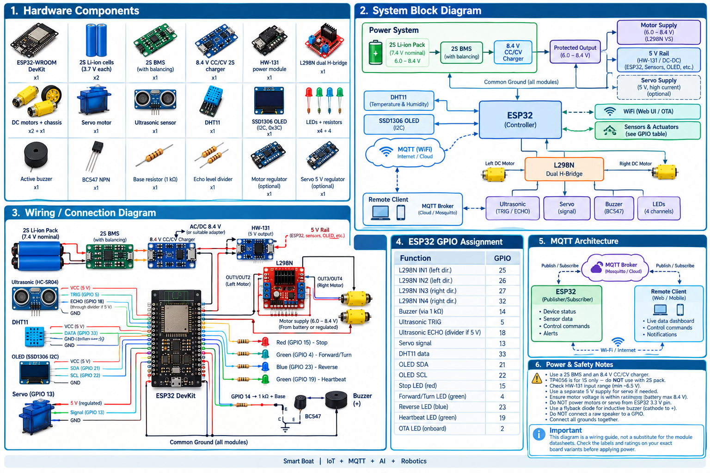
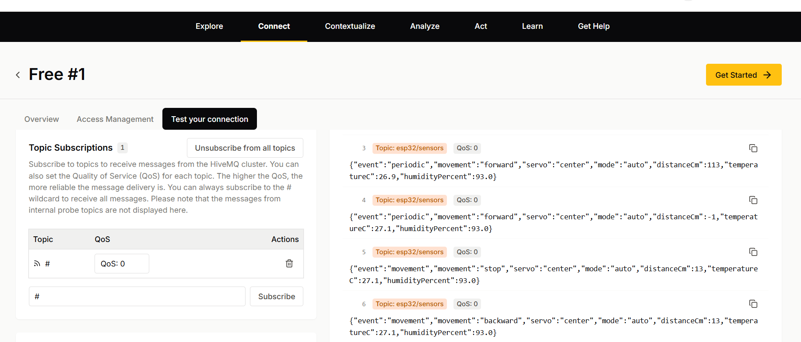
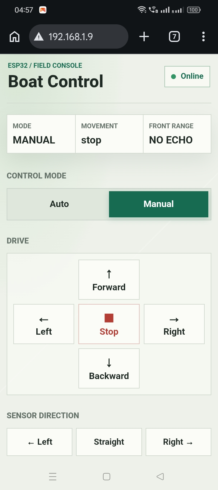
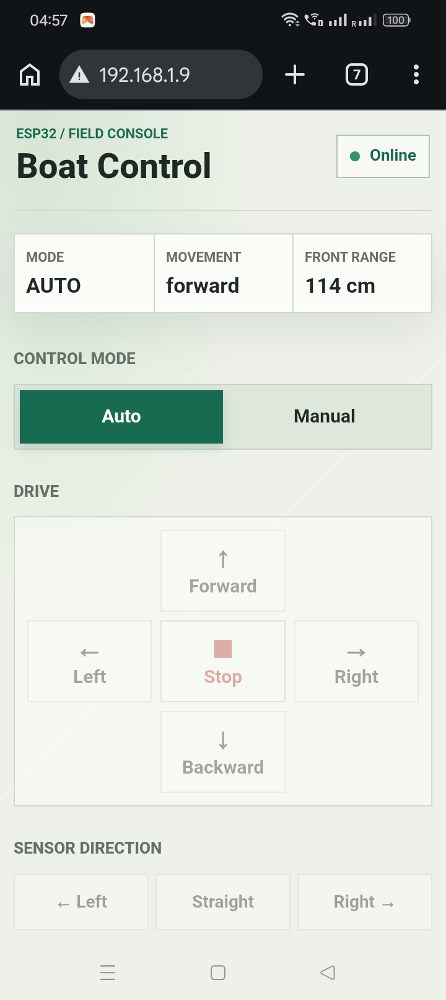
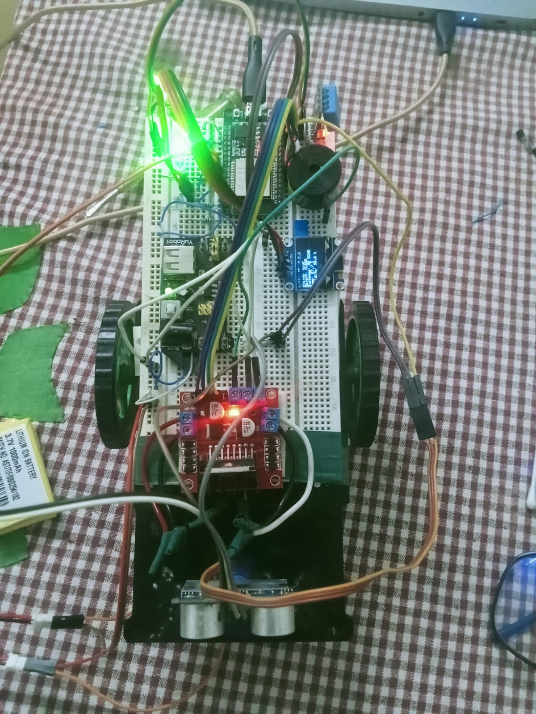
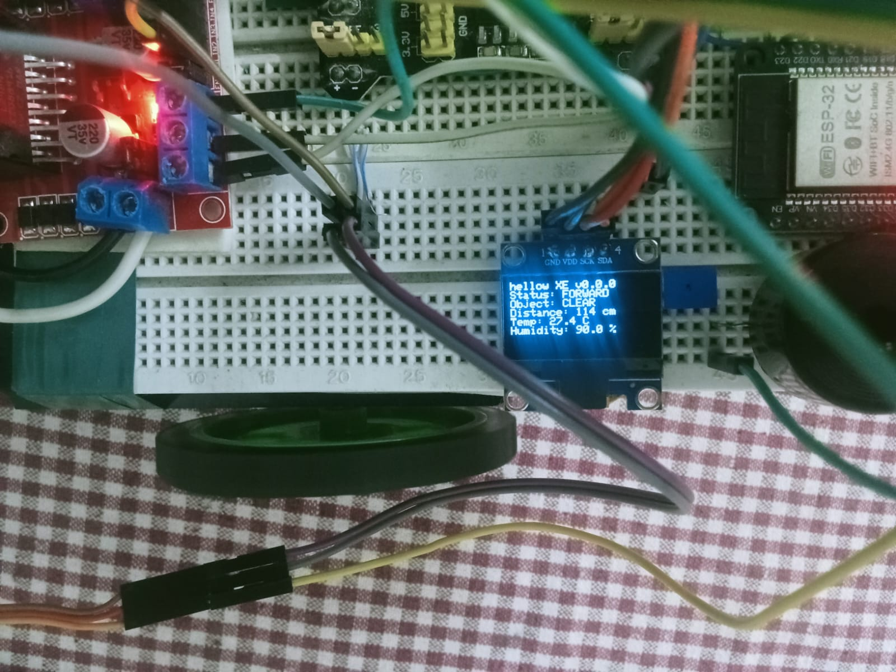

# AI Boat Firmware

[](https://github.com/VisioSphereAI/ai_boat/tags)


[](docs/hardware.md)
[](docs/operation.md#mqtt-telemetry)

> ESP32 WROOM two-wheel robot with autonomous obstacle avoidance and browser/text-command control.

**Platform:** ESP32 Arduino (`esp32dev`) · **Build:** PlatformIO · **Network:** Wi-Fi, HTTP, OTA, MQTT/TLS

## Overview

The firmware drives two DC motors through an L298N, scans with a servo-mounted ultrasonic sensor, and reports device state through an OLED, LEDs, buzzer, web UI, and MQTT. Audio recognition runs on an external Python, Android, or browser client; the ESP32 receives recognized text over HTTP.

## Project Gallery

### System and Telemetry

<table>
   <tr>
      <td width="100%" align="center"><br><sub>System overview</sub></td>
   </tr>
   <tr>
      <td width="100%" align="center"><br><sub>MQTT telemetry</sub></td>
    </tr>
</table>

### Robot and Interface

<table>
   <tr>
      <td width="50%" align="center"><br><sub>Manual control</sub></td>
      <td width="50%" align="center"><br><sub>Autonomous control</sub></td>
   </tr>
   <tr>
      <td width="50%" align="center"><br><sub>Robot hardware</sub></td>
      <td width="50%" align="center"><br><sub>Live OLED status</sub></td>
   </tr>
</table>

[Additional control-page image](img/control_pag1.png)

### Demonstration Videos

- [Robot demonstration — clip 1](img/WhatsApp%20Video%202026-09-28%20at%2006.11.50.mp4)
- [Robot demonstration — clip 2](img/WhatsApp%20Video%202026-09-28%20at%2006.11.57.mp4)

## Features

- **Autonomous obstacle avoidance:** median-filtered ultrasonic readings, servo-based side scans, differential steering, and configurable stop/clearance thresholds.
- **Three control modes:** Auto, Manual, and Audio. A local web page controls the robot; external clients can send recognized text commands over HTTP.
- **Collision-aware remote drive:** Forward and turns check the ultrasonic path and report blocked commands. Audio reverse is time-limited because there is no rear sensor.
- **Live onboard status:** the SSD1306 OLED displays movement, distance, temperature, and humidity; LEDs indicate motion/heartbeat, and the buzzer signals scans and avoidance actions.
- **Asynchronous MQTT telemetry:** a FreeRTOS worker publishes event-driven updates and periodic snapshots every 5 seconds to `esp32/sensors`, including distance, temperature, humidity, movement, servo position, and mode.
- **Remote maintenance:** Wi-Fi connectivity and password-protected ArduinoOTA firmware updates.
- **ESP32 development workflow:** PlatformIO `esp32dev` target plus an Arduino IDE entry point.

## Quick Start

1. Install Arduino ide and install packages
2. connect the ESP32 DevKit over USB.
3. Set private Wi-Fi and MQTT credentials in the firmware configuration.
4. Review the [hardware and power guide](docs/hardware.md), especially the 2S battery/charger warning.
5. Build and upload the firmware using PlatformIO or Arduino IDE.
6. Connect a laptop to the same Wi-Fi as the ESP32 and open the IP address printed in Serial Monitor.

## Documentation

| Guide | Contents |
| --- | --- |
| [System architecture](docs/architecture.md) | High-level diagram, operating modes, obstacle logic, MQTT data flow, safety boundaries |
| [Hardware and wiring](docs/hardware.md) | Component list, GPIO table, circuit diagrams, power and charging requirements |
| [Operation and APIs](docs/operation.md) | Auto/Manual/Audio operation, HTTP endpoints, recognized commands, Python example, MQTT payload |
| [Development and bring-up](docs/development.md) | Build/upload, first power-up, configuration, troubleshooting |

## Releases

- [v1.0.0](releases/v1.0.0.md) — initial autonomous boat firmware
- [v2.0.0](releases/v2.0.0.md) — browser-based Auto/Manual control
- [v3.0.0](releases/v3.0.0.md) — Audio mode and queued/event plus periodic MQTT telemetry

## Safety

**Do not charge two series-connected 3.7 V cells with a TP4056.** A 2S pack requires a 2S balancing BMS and a compatible 8.4 V charger. Verify all board input/current ratings, motor voltage, and ultrasonic ECHO level before wiring. Test with the chassis lifted and propellers clear.

The HTTP page has no authentication; keep it on a trusted local network. Audio recognition is client-side and does not run on the ESP32.

## Project Structure

```text
include/       Shared interfaces and hardware configuration
src/           Firmware modules and control logic
docs/          Architecture, hardware, operation, development
releases/      Versioned release notes
ai_boat.ino    Arduino IDE entry point
platformio.ini PlatformIO target and dependencies
```

---

**Documentation index:** start with [architecture](docs/architecture.md), [hardware](docs/hardware.md), [operation](docs/operation.md), or [development](docs/development.md).
ai_boat.ino                Arduino IDE entry point
```