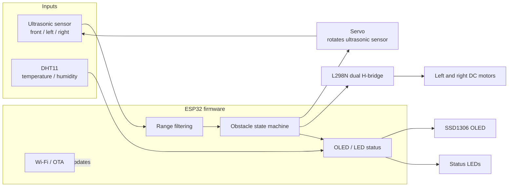
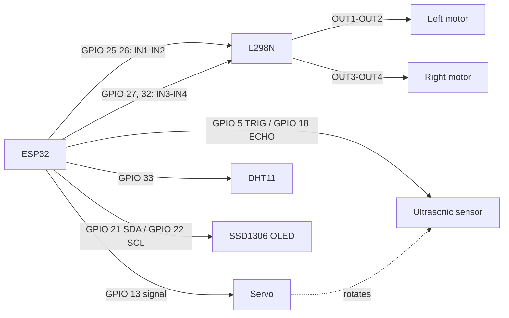
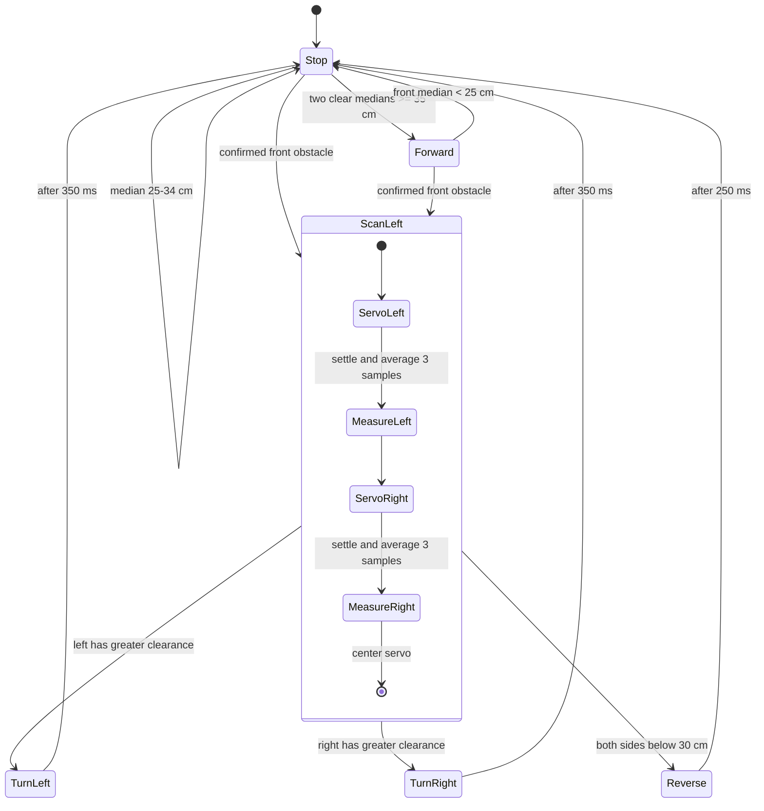

# ESP32 Obstacle-Avoiding Boat

Firmware for an ESP32 boat using an L298N dual H-bridge, two DC motors, a servo-mounted ultrasonic sensor, an OLED, and a DHT11. The controller samples the front range, scans both sides when an obstacle is close, and chooses a short turn or reverse action.

## System Block Diagram



## Wiring Map

| Device signal | ESP32 GPIO | Connection |
| --- | ---: | --- |
| L298N IN1 | 25 | Left motor direction input 1 |
| L298N IN2 | 26 | Left motor direction input 2 |
| L298N IN3 | 27 | Right motor direction input 1 |
| L298N IN4 | 32 | Right motor direction input 2 |
| Ultrasonic TRIG | 5 | Trigger input |
| Ultrasonic ECHO | 18 | Echo output, through a 5 V-to-3.3 V level divider when required |
| Servo signal | 13 | Sensor scanning servo |
| DHT11 data | 33 | Temperature/humidity data |
| OLED SDA | 21 | I2C data |
| OLED SCL | 22 | I2C clock |
| Stop LED | 15 | Red status LED |
| Forward/turn LED | 4 | Green status LED |
| Reverse LED | 23 | Blue status LED |
| Heartbeat LED | 19 | Green heartbeat |
| OTA LED | 2 | ESP32 onboard LED |



The firmware assumes the L298N `ENA` and `ENB` jumpers are installed, so both channels run at full speed. Use a suitable motor supply and servo supply; connect their grounds to ESP32 ground. Do not power motors from the ESP32 3.3 V pin. Confirm the ultrasonic ECHO voltage is safe for the ESP32 before connecting it.

## Obstacle Logic

The front distance is sampled three times and filtered with the median. A `pulseIn()` timeout is represented as no echo; it is treated as open range for navigation. The OLED reports `NO ECHO` when all three front samples time out.


The 25 cm stop and 35 cm resume thresholds provide hysteresis. The median rejects isolated spikes; each side uses three readings averaged together. A timeout is treated as open range, so a disconnected or miswired sensor can also appear clear. Test with the propellers clear of people and objects.

## Movement State Diagram



| State | Left motor | Right motor |
| --- | --- | --- |
| Forward | Forward | Forward |
| Backward | Backward | Backward |
| Left | Backward | Forward |
| Right | Forward | Backward |
| Stop | Stopped | Stopped |

## Runtime and Indicators

- The servo starts centered, then scans left and right only after a close front obstacle is detected.
- The OLED shows movement state, filtered front distance, temperature, and humidity.
- Red indicates stop, green indicates forward or turning, and blue indicates reverse. The heartbeat LED blinks once per second.
- Wi-Fi and password-protected ArduinoOTA are enabled. OTA handling runs in the main loop.
- The MQTT publish call is currently commented out; the firmware does not send sensor telemetry.
- Wi-Fi credentials are currently held in the firmware source. Move them to a private local configuration before sharing the project.

## Build and Upload

The project targets the PlatformIO `esp32dev` board with the Arduino framework:

```sh
pio run
```

Open `ai_boat.ino` for the Arduino IDE entry point. The application implementation is in `src/` and shared interfaces/configuration are in `include/`.

## Project Layout

```text
src/
  main.cpp                 Navigation and motor-driver control
  sensorData.cpp           Ultrasonic and DHT11 readings
  servoController.cpp      Sensor scanning servo
  displayController.cpp    SSD1306 status display
  ledcontroller.cpp        Movement and heartbeat LEDs
  ota.cpp                  Wi-Fi OTA setup and handling
include/
  config.h                 GPIO assignments and range thresholds
  constants.h              Movement and servo states
  main.h                   Application state
platformio.ini             ESP32 build configuration
ai_boat.ino                Arduino IDE entry point
```