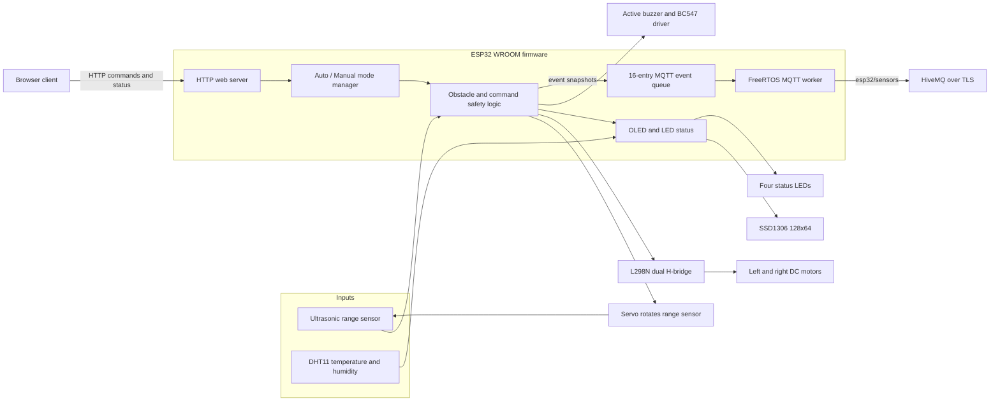
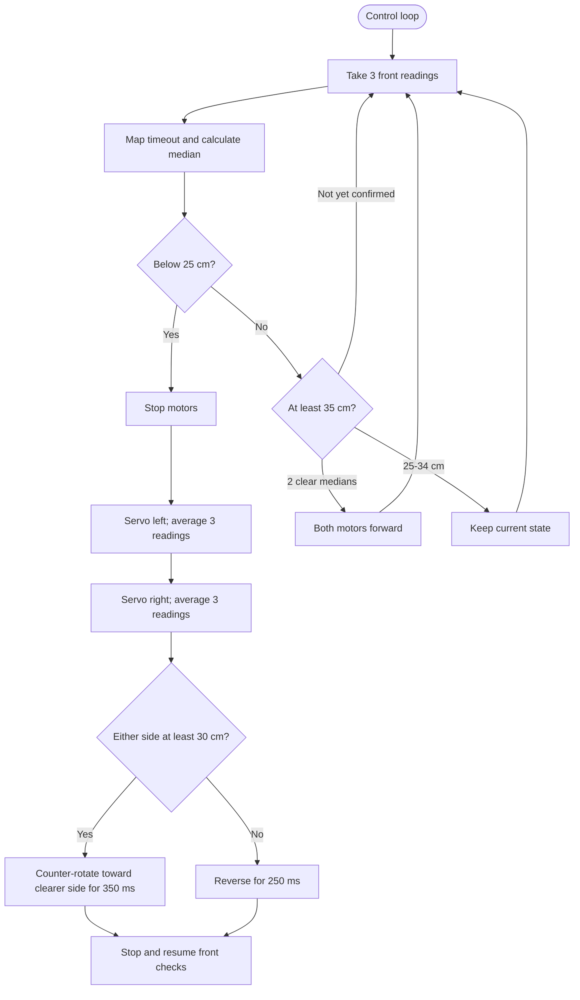
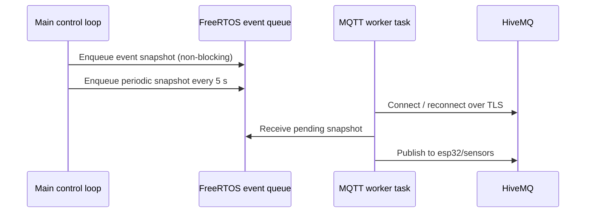

# System Architecture

[Back to project README](../README.md) | [Hardware and wiring](hardware.md) | [Operation and APIs](operation.md) | [Development](development.md)

## High-Level System Diagram

## Control Modes

| Mode | Controller | Behavior |
| --- | --- | --- |
| Auto | ESP32 | Samples the front range, stops for a detected obstacle, scans left/right, then turns toward available clearance or briefly reverses. |
| Manual | Browser | Hold-to-drive commands are sent over HTTP. Forward/left/right pass through ultrasonic clearance checks; manual drive has a command timeout. |

## Autonomous Decision Flow

Front readings use a median-of-three filter. The 25 cm stop and 35 cm resume thresholds provide hysteresis. A `pulseIn()` timeout is represented as no echo; autonomous mode treats it as open range after confirmation. A disconnected sensor can therefore appear clear.

## MQTT Data Path

The 16-entry queue carries boot, movement, mode, sensor-reading, and 5-second periodic events. If it fills while offline, the oldest queued event is discarded to make room for the latest state. Payload fields are documented in [Operation and APIs](operation.md).

## Safety Boundaries

- The ultrasonic sensor faces front/left/right only; reverse cannot be collision-checked.
- Manual reverse has no rear sensor protection.
- No-echo blocks manual forward. A manual turn can proceed on a side no-echo reading with a warning; Auto maps no-echo to max range.
- The browser server has no login and should remain on a trusted local Wi-Fi network.

---

*Architecture reference for the current firmware. See [hardware and wiring](hardware.md) before connecting power.*
