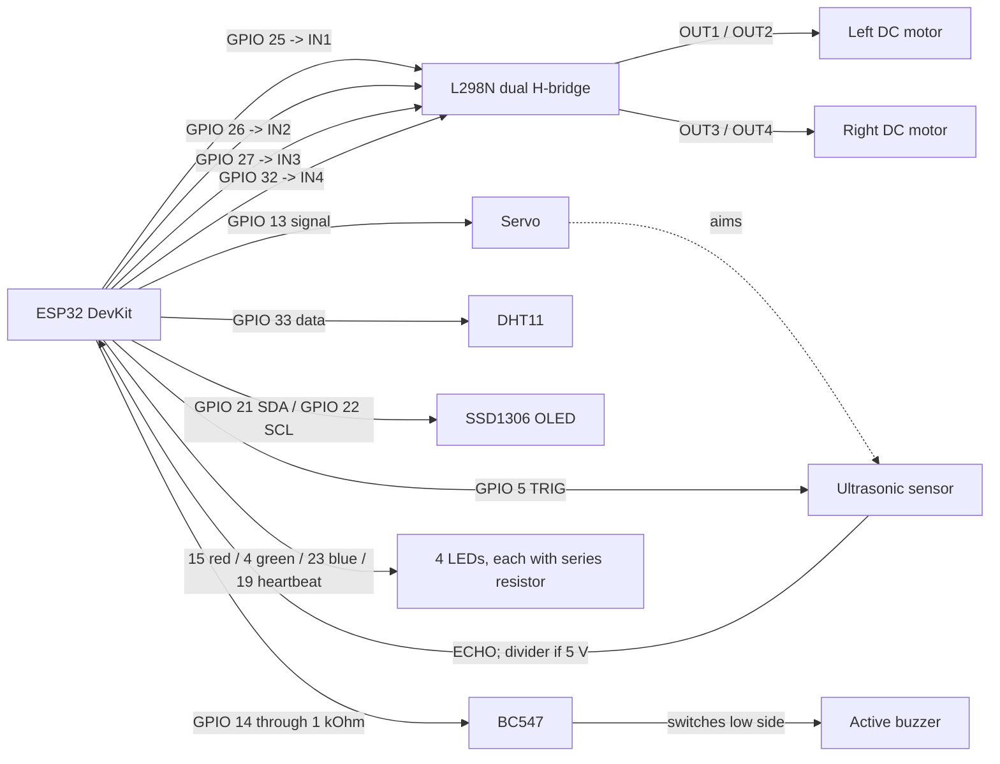
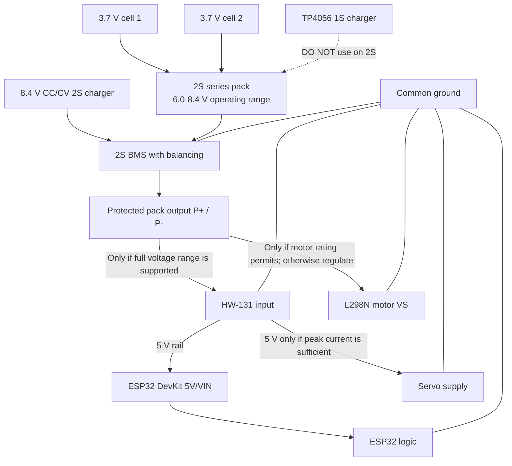

# Hardware, Components, and Wiring

[Back to project README](../README.md) | [Architecture](architecture.md) | [Operation and APIs](operation.md)

## Component List

| Component | Quantity | Notes |
| --- | ---: | --- |
| ESP32-WROOM development board | 1 | PlatformIO target is `esp32dev`; this assumes a DevKit-style board with USB and 5 V/VIN input. A bare WROOM module needs regulated 3.3 V and supporting circuitry. |
| 3.7 V Li-ion cells | 2 | The current pack is described as series-connected (2S). Use matched cells of the same type, capacity, and state of charge. |
| 2S BMS with balancing | 1 | Required protection for a series two-cell pack; connect cell taps and pack terminals exactly as marked by that board. |
| 8.4 V CC/CV 2S charger | 1 | Required for a 2S pack. The BMS is not a charger. |
| TP4056 1S charging module | 1 | **Not compatible with the series 2S pack. Do not connect it to this pack.** It is for one Li-ion cell. |
| HW-131 breadboard power module | 1 | Verify its exact input range, rail selection, and output-current/thermal limits. |
| L298N dual H-bridge | 1 | ENA/ENB jumpers are assumed fitted for full-speed drive. |
| Brushed DC motors and two-wheel chassis | 2 motors, 1 chassis | Confirm motor voltage/current before choosing the motor supply rail. |
| Servo motor | 1 | Signal on GPIO 13; use a suitable regulated supply for its peak current. |
| Ultrasonic range module | 1 | TRIG/ECHO interface; level-shift ECHO if it can output 5 V. |
| DHT11 module/sensor | 1 | GPIO 33 data; a bare sensor may need a 4.7-10 kOhm pull-up to 3.3 V. |
| SSD1306 OLED, 128 x 64, I2C | 1 | I2C address `0x3C`. |
| LEDs | 4 | Red stop, green forward/turn, blue reverse, green heartbeat. |
| LED series resistors | 4 | Use one per LED; 220-330 Ohm is a typical starting range. |
| Two-pin active buzzer | 1 | Verify rated voltage and current; a passive piezo requires a tone/PWM drive instead. |
| BC547 NPN transistor | 1 | Low-side buzzer switch. Check the transistor pinout for the exact manufacturer/package. |
| Base resistor | 1 | 1 kOhm from GPIO 14 to the BC547 base. |
| Echo level divider | 1 | Required if the ultrasonic ECHO output is 5 V; scale it to a safe ESP32 input voltage. |
| Motor regulator (conditional) | 1 | Needed if the protected battery voltage exceeds the motors' rating. |
| Servo 5 V regulator (conditional) | 1 | Use a separate adequately rated supply if the HW-131 cannot support servo peak current. |

## ESP32 GPIO Assignment

| Function | ESP32 GPIO | Connect to |
| --- | ---: | --- |
| L298N left direction IN1 | 25 | L298N IN1 |
| L298N left direction IN2 | 26 | L298N IN2 |
| L298N right direction IN3 | 27 | L298N IN3 |
| L298N right direction IN4 | 32 | L298N IN4 |
| Buzzer control | 14 | 1 kOhm resistor, then BC547 base |
| Ultrasonic trigger | 5 | Sensor TRIG |
| Ultrasonic echo | 18 | Sensor ECHO through level divider if required |
| Sensor servo signal | 13 | Servo signal wire |
| DHT11 data | 33 | DHT11 data |
| OLED SDA | 21 | OLED SDA |
| OLED SCL | 22 | OLED SCL |
| Stop LED | 15 | Series resistor then red LED anode |
| Forward/turn LED | 4 | Series resistor then green LED anode |
| Reverse LED | 23 | Series resistor then blue LED anode |
| Heartbeat LED | 19 | Series resistor then green LED anode |
| OTA LED | 2 | ESP32 onboard LED |

## Signal and Motor Wiring

The firmware applies opposite logic polarity to the right motor channel to compensate for the current motor orientation/wiring. If a motor direction is wrong, first verify which motor is on OUT1/OUT2 versus OUT3/OUT4, then swap that motor's two output wires if needed.

## Power Wiring and Charging Safety

The two 3.7 V cells in series form a 2S pack: approximately 7.4 V nominal and 8.4 V fully charged. It may fall to about 6.0 V near discharge. Do **not** charge this pack with a TP4056; TP4056 is a one-cell (1S) charger. Use a 2S balancing BMS and a compatible 8.4 V CC/CV charger. A BMS is not a charger.

The exact HW-131 input rating varies. Many HW-131/MB102 modules specify a minimum input around 6.5 V, while a 2S pack may drop to approximately 6.0 V. Connect directly only if the exact module accepts the complete battery range; otherwise add a suitable DC/DC input converter. Its onboard regulators may overheat or reset the ESP32 under servo load; use a separate regulated 5 V servo supply if needed. Connect all grounds together.

Before powering the L298N, check the motor voltage rating against the battery's fully charged 8.4 V. Regulate the motor supply if necessary. Follow the specific L298N board's `5V-EN` jumper instructions and avoid tying two regulator outputs together. Do not power motors or a servo from the ESP32 3.3 V pin. A bare ESP32-WROOM module must never receive 5 V.

## Buzzer and LEDs

- Buzzer: GPIO 14 -> 1 kOhm resistor -> BC547 base; emitter -> common ground; collector -> buzzer negative; buzzer positive -> its rated supply. For an inductive buzzer, add a flyback diode with cathode toward positive. Never connect a raw speaker directly to a GPIO.
- LEDs: each GPIO drives its own series resistor and LED anode; each LED cathode returns to ground. Do not share one resistor among multiple LEDs.

---

*Check the labels and ratings printed on your exact board variants before applying power. This diagram is a wiring guide, not a substitute for the module datasheets.*
