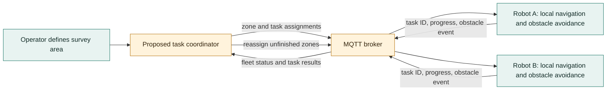
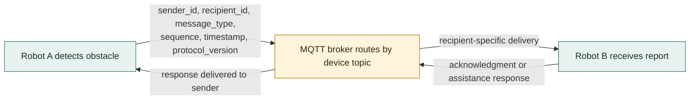
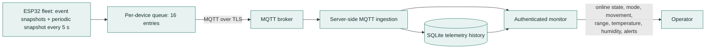
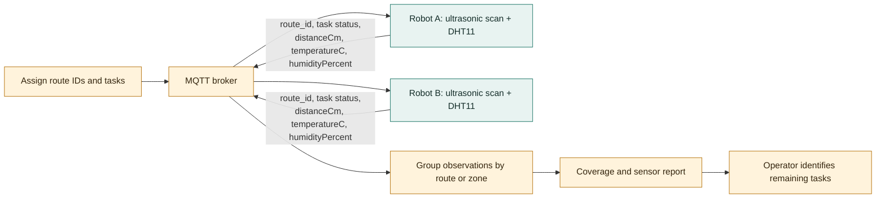
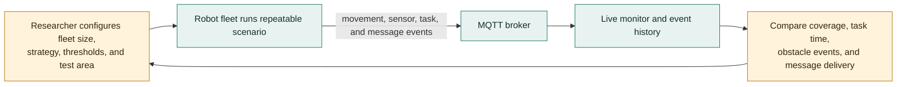
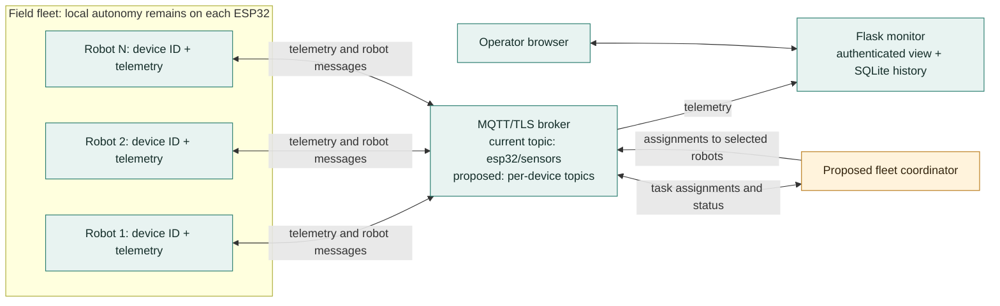

# Project Proposal: Connected Autonomous Robot and Swarm Platform

## Executive Summary

This project develops an affordable, connected autonomous robot platform using an ESP32-WROOM controller. The current prototype is a two-wheel mobile robot that can avoid obstacles, accept browser-based manual commands, and publish sensor and movement telemetry over MQTT. An authenticated monitoring application collects and displays that telemetry.

The proposed work builds on that working single-robot foundation. It will add support for multiple uniquely identified robots, robot-to-robot information exchange, coordinated swarm activities, and a centralized operator view. The platform is intended for education, research, and small-scale field demonstrations; it is not a substitute for safety-rated industrial or marine autonomy systems.

## Problem and Opportunity

A single robot can explore a small area, but its coverage, perspective, and ability to recover from local obstacles are limited. Operating several independent robots can improve coverage and resilience, but requires a consistent way to identify devices, share useful observations, coordinate tasks, and monitor the fleet. The current telemetry monitor offers a starting point for fleet visibility, while the firmware's existing autonomous navigation and MQTT publishing provide a starting point for connected robots.

## Proposed Solution

Extend the current firmware and monitoring system into a modular, multi-robot platform. Each robot will retain local control and obstacle avoidance so that basic movement does not depend on a server connection. A shared MQTT broker will carry robot telemetry and coordination messages. The central monitoring application will present fleet status, history, and alerts, while a future coordination service can assign tasks and relay messages between robots.

Robot identity, message versioning, and per-device topics should be introduced before multi-robot coordination. A robot should continue to stop safely or use its local autonomous behavior if the network, broker, or central service becomes unavailable.

## Current Prototype Snapshots

These images show the existing single-robot hardware and interfaces that this proposal builds on.

<table>
  <tr>
    <td align="center" width="50%"></td>
    <td align="center" width="50%"></td>
  </tr>
  <tr>
    <td align="center"><em>Physical ESP32 rover prototype</em></td>
    <td align="center"><em>On-device autonomous and manual controls</em></td>
  </tr>
</table>

<em>Current centralized telemetry monitor snapshot; fleet selection and multi-robot views are proposed extensions.</em>

## Goals

- Preserve reliable local manual control and autonomous obstacle avoidance.
- Give every robot a stable, configurable device ID and distinguish its telemetry and commands.
- Support centrally monitored status, sensor readings, connectivity, and alerts across multiple robots.
- Enable robots to exchange observations and coordination messages through a defined protocol.
- Demonstrate a small swarm completing a shared task, such as dividing an exploration area.
- Keep the design modular and affordable, using the existing ESP32, MQTT, and Flask foundations where practical.

## Use Cases

### 1. Swarm Robotics and Cooperative Exploration

Several robots explore separate sections of a test area. A coordinator assigns zones or tasks, and robots report progress and obstacles. When a robot finds a blocked route or an area of interest, the fleet can update assignments to reduce duplicated effort. The first demonstration can use simple rules and a small number of robots; advanced swarm optimization is a later extension.

### 2. Robot-to-Robot Communication

Robots share compact messages such as position or zone estimates, obstacle reports, task status, and assistance requests. Messages can be routed through the MQTT broker initially, allowing the system to work over existing Wi-Fi without requiring direct radio links. Direct ESP-NOW or another peer-to-peer transport can be evaluated later for areas without infrastructure. Messages should include sender ID, timestamp or sequence number, type, and protocol version.

### 3. Centralized Fleet Monitoring

An operator uses the authenticated monitoring dashboard to see each robot's online state, operating mode, movement, latest sensor readings, and recent events. Fleet-level history and alerts help identify stale telemetry, repeated obstacle encounters, or a robot that has stopped reporting. Existing SQLite-backed telemetry history can be extended with device identity and fleet filters.

### 4. Remote Supervision and Manual Recovery

An operator selects a robot, reviews its latest status, and switches it to manual control when autonomous progress is blocked. Remote commands must be authenticated, scoped to one device, rate-limited where appropriate, and subject to a command timeout and local safety checks. The current unauthenticated onboard HTTP control page should remain limited to a trusted development network until access controls are added.

```mermaid
flowchart LR
  Operator[Operator selects robot] --> Dashboard[Proposed authenticated fleet control]
  Dashboard -->|authorize, target ID, command| Gateway[Command gateway]
  Gateway -->|scoped command over MQTT| Broker[MQTT broker]
  Broker --> Robot[Target ESP32: Auto or Manual]
  Robot --> Safety[Local checks: 900 ms manual timeout;<br/>front stop 25 cm; clear at 35 cm;<br/>side clearance 30 cm]
  Safety --> Motors[L298N and two drive motors]
  Robot -->|command result and telemetry| Broker
  Broker --> Dashboard

  classDef existing fill:#e8f3f1,stroke:#23796b,color:#142d29
  classDef planned fill:#fff3dc,stroke:#b87816,color:#34250e
  classDef safety fill:#fce9e7,stroke:#b74437,color:#3b1b18
  class Robot,Motors existing
  class Operator,Dashboard,Gateway,Broker planned
  class Safety safety
```

### 5. Distributed Inspection and Environmental Survey

Robots cover multiple routes in a test site and report range readings and available environmental measurements. A central view combines reports into a basic site survey and indicates which areas still need inspection. The present hardware measures ultrasonic distance, temperature, and humidity; additional sensing capabilities would require separate hardware and validation.

### 6. Education and Robotics Research

Students can compare centralized, decentralized, and hybrid coordination strategies using the same robot hardware and telemetry format. The platform provides visible results through the robots, MQTT events, and dashboard without requiring a high-cost commercial fleet system.

## Proposed Fleet Block Diagram

In the initial design, robot-to-robot messages are broker-mediated rather than direct: a robot publishes to its device topic, and the broker routes the message to its intended recipient. The local navigation loop remains on each ESP32. The monitor and broker are part of the existing foundation; multi-robot identity, fleet views, and the task coordinator are proposed additions.

## Implementation Plan

1. **Harden the single-robot foundation:** document device configuration, verify safe stop behavior during network loss, and keep manual control restricted to trusted networks.
2. **Add multi-robot identity:** add a stable device ID to telemetry, commands, storage, and dashboard views; define versioned MQTT topic and payload conventions.
3. **Build fleet monitoring:** display multiple devices, online/stale status, latest telemetry, event history, and basic alerts in the authenticated monitor.
4. **Add messaging and task assignment:** define broker-mediated robot messages and introduce a minimal coordinator that can assign a task to a selected robot.
5. **Demonstrate swarm behavior:** test two or more robots on a bounded exploration or coverage task, measure task completion and communication reliability, and document limitations.
6. **Evaluate optional peer-to-peer networking:** compare broker-mediated communication with ESP-NOW or another suitable link only if operation without Wi-Fi infrastructure is a demonstrated requirement.

## Deliverables

- Updated firmware supporting unique robot identity and safe behavior during communication loss.
- Documented MQTT topic, payload, and command conventions for a multi-robot fleet.
- Fleet monitoring views with per-robot status, history, and basic alerts.
- A minimal coordination demonstration for a shared multi-robot task.
- Setup, test, and operator documentation, including known safety and network limitations.

## Success Measures

- At least two robots can publish distinguishable telemetry to one monitor.
- The dashboard identifies online robots and flags telemetry that has gone stale.
- A message from one robot can be delivered to another through the coordination path and correlated to its sender and recipient.
- Robots continue local safety behavior and stop or enter a defined safe state when communication is lost.
- In a repeatable bounded-area test, multiple robots complete an assigned task with measurable coverage and without uncontrolled collisions.
- Remote monitoring and commands are protected by documented authentication and deployment controls.

## Scope and Assumptions

The current prototype is a two-wheel ESP32 rover with ultrasonic obstacle sensing, a servo-mounted sensor, DHT11, OLED, LEDs, buzzer, Wi-Fi, MQTT/TLS telemetry, and browser control. The project name includes “boat,” but the documented hardware and current navigation behavior are for a wheeled robot; water operation is outside this proposal unless the hardware and safety design are changed.

The first multi-robot version assumes Wi-Fi coverage and an MQTT broker reachable by the robots. Localization, GPS, mapping, collision-safe operation among moving robots, and direct long-range radio are not current capabilities and would require additional hardware or engineering. A centralized monitor provides observability; it does not by itself provide autonomous coordination.

## Risks and Mitigations

| Risk | Mitigation |
| --- | --- |
| Wi-Fi or broker loss interrupts coordination | Keep obstacle avoidance and safe-stop behavior local; define reconnect and stale-command handling. |
| Duplicate IDs or ambiguous messages cause cross-device control | Configure and validate stable IDs; include sender, target, message type, and protocol version. |
| Robots collide or block one another | Begin with bounded, low-speed trials and simple separation rules; do not treat ultrasonic sensing as full collision protection. |
| Telemetry volume or stale data obscures fleet status | Use per-device topics, timestamps or sequence numbers, bounded history, and explicit stale indicators. |
| Remote access exposes devices or credentials | Keep broker credentials private, use TLS and authenticated monitoring, and add authorization before enabling remote fleet commands. |
| Power instability resets the controller or motors | Validate battery, regulator, motor, and servo supplies under load before multi-robot trials. |

## Conclusion

The existing robot and telemetry monitor provide a practical base for a connected fleet project. The recommended path is to make the single-robot protocol device-aware first, build centralized fleet monitoring next, and then add robot-to-robot messaging and a small, measurable swarm demonstration. This sequence keeps local safety behavior independent of cloud or broker availability while making each stage testable.