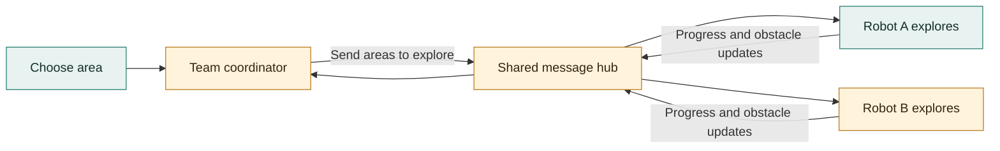
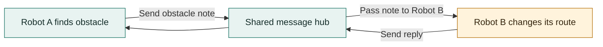
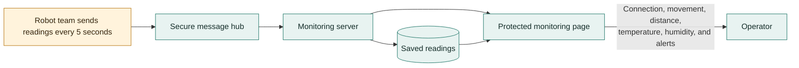
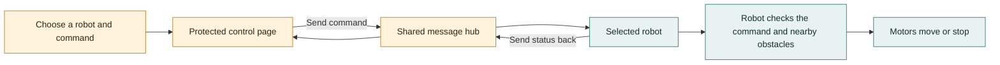
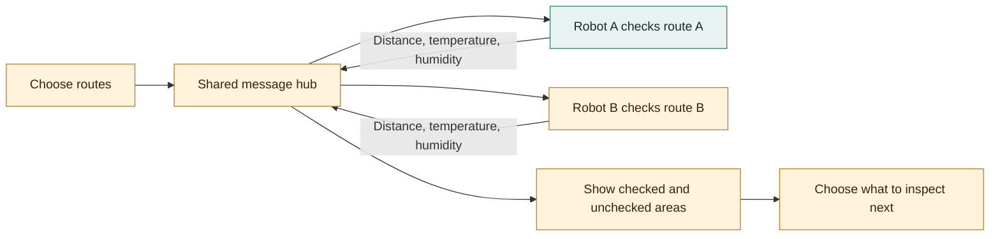
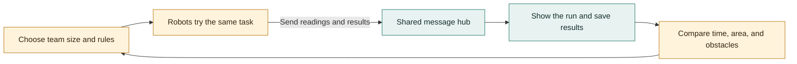
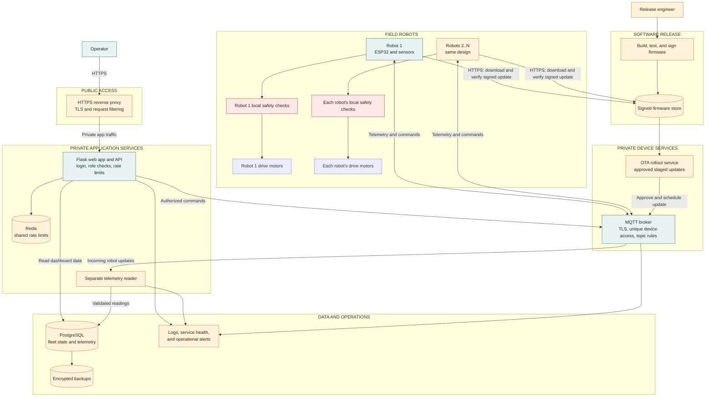

# Project Proposal: Connected Autonomous Robot and Swarm Platform

## Executive Summary

This proposal grows the current ESP32 robot into a small team of robots that can explore, share what they find, and be watched from one dashboard. Today, one robot can avoid obstacles, be controlled from a browser, and send its readings to a protected monitoring page.

The next steps are to connect several robots, let them pass messages, and coordinate simple shared tasks. The project is intended for learning and small demonstrations, not for work that requires certified safety equipment.

## Problem and Opportunity

One robot can only cover so much ground. A team could cover more area, share obstacle reports, and help an operator see what is happening. For this to work, each robot needs its own name and a reliable way to send updates.

## Proposed Solution

Build on the robot and dashboard already in place. Each robot will keep its own obstacle-avoidance and stop controls, even if Wi-Fi is lost. A shared message hub will pass updates between robots and the dashboard. A future coordinator can give each robot a different area to explore.

First, give each robot a unique name. Then add team messages and shared tasks. If the network stops working, the robot must still use its local safety controls.

## Current Prototype Snapshots

These images show the robot and tools already built.

<table>
  <tr>
    <td align="center" width="50%"></td>
    <td align="center" width="50%"></td>
  </tr>
  <tr>
    <td align="center"><em>Robot prototype</em></td>
    <td align="center"><em>Robot control page</em></td>
  </tr>
</table>

<em>Current monitoring page; team and fleet views are future additions.</em>

## Goals

- Keep each robot able to move and stop safely on its own.
- Give every robot a unique name.
- Show all robots and their latest readings on one monitoring page.
- Let robots share obstacle and task updates.
- Demonstrate a small team exploring different areas.
- Reuse the current, low-cost robot and monitoring setup.

## Use Cases

These diagrams show how each idea could work. Green marks features already present in the single-robot project; amber marks planned team features.

### 1. Swarm Robotics and Cooperative Exploration

Robots explore different parts of an area. They report what they find, and the coordinator can send them to areas that still need checking.

### 2. Robot-to-Robot Communication

Robots can send each other simple updates, such as “obstacle ahead,” “area checked,” or “need help.” At first, these messages travel through the shared Wi-Fi connection. A direct robot-to-robot radio link could be explored later.

### 3. Centralized Fleet Monitoring

The operator sees which robots are connected, what they are doing, and their latest readings. The page can keep a history and flag a robot that has stopped sending updates.

### 4. Remote Supervision and Manual Recovery

If a robot gets stuck, the operator can select it and take control. Team control must require a login and still obey the robot's local safety checks. The current robot control page is only for a trusted local network; secure team control is future work.

### 5. Distributed Inspection and Environmental Survey

Robots follow separate routes and report distance, temperature, and humidity. The operator sees which areas have been checked and which still need a visit. Other measurements would need extra sensors.

### 6. Education and Robotics Research

Students can try different ways for robots to share work, then compare how long each approach takes and how much area it covers.

## Implementation Plan

1. Check that one robot stops safely if Wi-Fi is lost.
2. Give each robot a unique name and show it in its updates.
3. Update the dashboard to show the whole team and warn when a robot goes quiet.
4. Let robots share simple messages and receive different tasks.
5. Test two or more robots exploring a small, safe area.
6. Consider direct radio links only if the team must work without Wi-Fi.

## Deliverables

- Robot software with a unique name for each robot.
- A shared way for robots to send updates and task messages.
- A monitoring page showing each robot, its readings, and alerts.
- A small demonstration where robots share an exploration task.
- Setup and safety instructions.

## Success Measures

- Two or more robots appear separately on one monitoring page.
- The page shows when a robot stops sending updates.
- One robot can send a message that another robot receives.
- Each robot still uses its own safety controls when Wi-Fi is unavailable.
- In a small test area, the robots complete a shared task without colliding.
- Remote controls require a login.

## Scope and Assumptions

The current prototype is a two-wheel robot. It measures nearby distance, temperature, and humidity, and has a small screen, lights, and a buzzer. Although the project is called “AI Boat,” this hardware runs on wheels and is not designed for water.

The first team of robots will need Wi-Fi. The robots do not currently know their exact location or build maps. The monitoring page shows information but does not make the robots coordinate by itself.

## Risks and Mitigations

| What could go wrong | How to reduce the risk |
| --- | --- |
| Wi-Fi disconnects | Keep obstacle avoidance and stop controls on each robot. |
| Robots get mixed up | Give each robot a unique name and label its messages. |
| Robots bump into each other | Test slowly in a clear, bounded area; the current sensor cannot see in every direction. |
| The dashboard misses an update | Show when each robot last checked in. |
| Someone gets access to remote controls | Require a login and keep passwords private. |
| Motors or sensors lose power | Test the battery and power wiring before each demonstration. |

## Conclusion

The current robot and monitoring page are a good starting point. Add team features in stages: name each robot, show them together, let them share updates, and then test a small shared task. Keep each robot's safety controls working on their own.

## Production Target Architecture

This is a proposed production design, not a description of features already deployed. Green marks the working prototype; amber marks recommended production additions; red marks safety controls that stay on each robot.

The current project has one robot, a Flask monitor that also reads MQTT, MQTT over TLS, SQLite history, and password-protected ArduinoOTA. The production design separates telemetry reading from the web app, uses a database suited to multiple services, adds per-robot broker permissions, and sends signed updates through a controlled release process. These are recommendations that require implementation and testing before production use.

Keep movement safety local: the robot stops for obstacles closer than 25 cm, waits for 35 cm of clear space before moving again, uses 30 cm as its side-clearance guide, and stops manual movement after about 900 ms without a command. Robot readings are sent every 5 seconds. The current password-protected ArduinoOTA should only be used on a trusted network; signed updates and staged rollout are proposed production improvements.