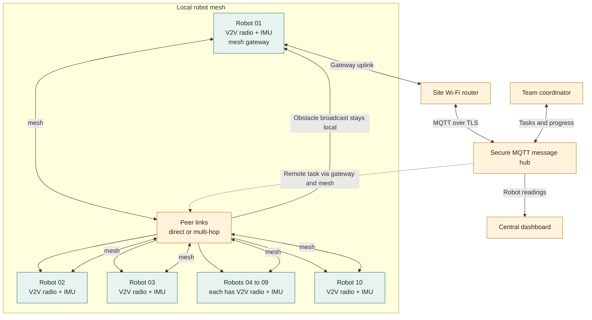
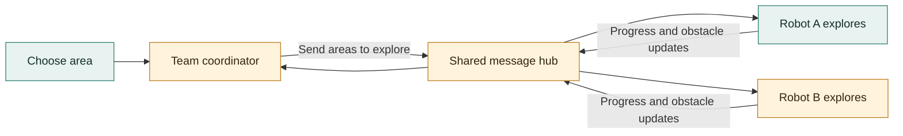
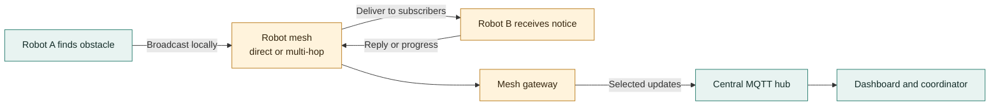
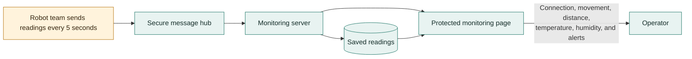
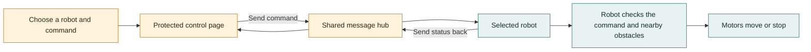
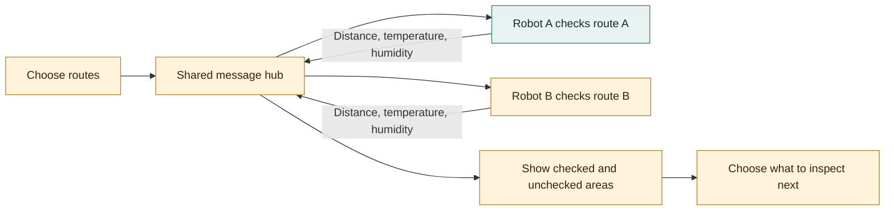
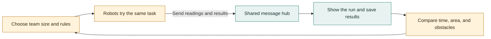
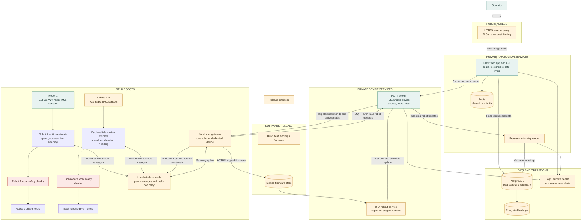

# Project Proposal: Connected Autonomous Robot and Swarm Platform

> **From one robot to a team that works together.** Two small robots explore a marked test area, share obstacle reports, and show their progress on one monitoring page.

## Executive Summary

One robot can avoid obstacles. A team can also share discoveries, divide work, and show an operator what is happening across the whole test area. This proposal grows the existing ESP32 robot and monitoring page into that team.

The current prototype already drives, avoids obstacles, accepts browser controls, and sends readings to a protected monitoring page. The proposed next step is to connect several robots and coordinate a simple shared task. The platform is intended for learning and small demonstrations, not for work that requires certified safety equipment.

## Problem and Opportunity

One robot can only cover so much ground. A team could cover more area, share obstacle reports, and help an operator see what is happening. For this to work, each robot needs its own name and a reliable way to send updates.

## Proposed Solution

Build on the robot and dashboard already in place. Each vehicle will add an onboard inertial measurement unit (IMU) and a dedicated vehicle-to-vehicle (V2V) radio module. The IMU measures acceleration and rotation; the radio shares motion estimates over the local mesh. A mesh gateway connects the team to the MQTT message hub and dashboard. Each vehicle keeps its own obstacle-avoidance and stop controls.

First, give each robot a unique name. Then add team messages and shared tasks. If the network stops working, the robot must still use its local safety controls.

## Current Prototype Snapshots

These images show the robot and tools already built.

<table>
  <tr>
    <td align="center" width="50%"></td>
    <td align="center" width="50%"></td>
  </tr>
  <tr>
    <td align="center"><em>Robot prototype</em></td>
    <td align="center"><em>Robot control page</em></td>
  </tr>
</table>

<em>Current monitoring page; team and fleet views are future additions.</em>

## First Demonstration: Two Robots, One Survey

Set up two vehicles at opposite ends of a room divided into clearly marked zones. Each has the new V2V radio and IMU. An operator assigns each a different zone from the monitoring station. As they move, they share their zone, motion estimate, and sensor readings. If one encounters a blocked route, it broadcasts an obstacle report; the operator can redirect the other to an unvisited zone.

The demonstration needs a bounded test area, two mesh-capable robots, and one mesh gateway with a Wi-Fi uplink. It does not depend on GPS or automatic map building. The audience can see the team status update live, then compare which zones were checked and how often the robots had to change plans.

**A successful demo means:** both robots appear separately on the dashboard, one robot's obstacle report reaches the other, and each robot still stops safely if the network is interrupted.

## Example: A 10-Robot Team

For a larger demonstration, label the robots `robot-01` through `robot-10` and mark ten work zones on the floor. The robots form a local wireless mesh, passing messages directly or through nearby robots when needed. One mesh node acts as the gateway to the site's Wi-Fi network and securely connects the team to the MQTT message hub, dashboard, and task coordinator.

### What Each Part Means

- **Robot 01 to Robot 10:** ten separate vehicles, each with its own name, sensors, motors, IMU, and dedicated V2V radio module. `Robots 04 to 09` is one combined drawing box for six vehicles; they connect and behave like the individually drawn vehicles. Robot 01 also acts as the mesh gateway in this example.
- **Local robot mesh:** a shared wireless network between the robots. Nearby robots can exchange messages directly; robots farther apart can pass messages through other mesh nodes. The `Peer links` box represents this network, not a separate physical device or fixed wiring pattern.
- **Mesh gateway:** Robot 01 also connects the local mesh to the site's Wi-Fi router. A dedicated gateway could be used instead in a larger deployment.
- **Secure MQTT message hub:** the central traffic director. The gateway forwards team updates and remote tasks between the mesh and the dashboard or coordinator. Local robot-to-robot broadcasts can continue within mesh range without going through the central dashboard.
- **Central dashboard:** the operator's view of which robots are connected, where work is assigned, and what each robot has reported.
- **Team coordinator:** assigns work and tracks progress. A future version can run as software alongside the dashboard or as a separate service.
- **Arrows:** mesh links show that robots can pass messages between peers. The gateway-to-router arrow carries mesh traffic to and from the central services. The dashed line shows a remote task returning through the gateway and mesh. The double arrow between coordinator and hub carries assignments out and progress back.

### Example Message Journey

1. Robot 03 uses its IMU to update its motion estimate and its V2V radio to share its zone, speed, acceleration, and heading with nearby vehicles.
2. If Robot 03 detects an obstacle, it sends a separate urgent notice over the local mesh.
3. Nearby vehicles receive both updates directly; more distant vehicles receive them through other mesh nodes. The gateway can also forward selected reports to the dashboard and coordinator.
4. Vehicles use the shared information to improve coordination, but each still follows its own safety checks. The coordinator decides whether to change assignments.
5. If the coordinator assigns Robot 07 a new zone, the task travels from the hub through the gateway and mesh to Robot 07 only; Robot 07 reports its progress back.

**How sharing works:** each vehicle has a unique name, such as `robot-03`. Its dedicated V2V radio broadcasts a small motion message containing the sender, time, sequence number, zone or estimated position, speed, acceleration, and heading. Urgent obstacle notices use a separate message type. Mesh nodes relay messages when needed; the gateway forwards selected updates to the central dashboard. Tasks for an individual vehicle are addressed by its unique name.

The coordinator sends a task to one robot using its individual address. Every message includes the sender, time, message type, and a unique message number so the receiver can identify it and ignore duplicates. Commands are addressed to a specific robot and expire; each robot still checks commands locally and stops if control updates cease.

| Setting | Example for 10 robots |
| --- | --- |
| Robot names | `robot-01` to `robot-10`, each unique and kept after reboot |
| Network | Local mesh between robots; one root/gateway connects the mesh to the site's Wi-Fi and message hub |
| Access | Unique secure identity for each robot; messages identify their sender and target, and hub rules limit central commands |
| Mesh design | Select an ESP32-compatible mesh method; test range, number of hops, and compatibility with the current Arduino/PlatformIO firmware |
| Onboard motion sensor | Add an IMU to every vehicle; sample its acceleration and rotation locally, then calculate a filtered motion estimate |
| V2V motion updates | Start at 5 updates per second per vehicle over the V2V mesh; verify radio capacity and delay before increasing the rate |
| Motion message | Include vehicle ID, timestamp, sequence number, zone or estimated position, speed, acceleration, heading, and message type |
| Regular status | One update every 5 seconds per robot, matching the current prototype interval; 10 robots average about 2 regular updates per second |
| Urgent events | Send obstacle or help messages immediately, separate from regular status updates |
| Mesh forwarding | Include a message ID and hop limit so a broadcast is not repeated forever |
| Gateway recovery | Test how another mesh node can take over the gateway role if the gateway or its uplink is lost |
| Missing robot | Mark it offline after 15 seconds without an update (three missed intervals); tune this after testing Wi-Fi reliability |
| Team tasks | Use named floor zones because the current robot does not know its precise location or build a map |
| Network loss | Local mesh messages can continue without internet; the dashboard may go stale until the gateway reconnects. Each robot keeps its own stop behavior and discards expired commands. |

These are starting settings for a proposed fleet test, not current multi-robot capabilities. Today, the firmware publishes to the shared `esp32/sensors` topic over Wi-Fi; mesh networking, mesh-to-Wi-Fi gateway behavior, unique robot identities, individual topics, and broadcast events still need to be implemented.

**Position accuracy:** an IMU measures acceleration and rotation; it does not directly measure speed or absolute position. Speed and position calculated from those readings drift over time. For reliable location, combine the IMU with GPS outdoors or another positioning method indoors. Until then, the first test can share marked zone IDs and short-term motion estimates rather than claiming precise coordinates.

## Goals

- Keep each robot able to move and stop safely on its own.
- Give every robot a unique name.
- Add a V2V radio and IMU to each vehicle.
- Share motion updates and obstacle reports over the local mesh.
- Show all robots and their latest readings on one monitoring page.
- Let robots share obstacle and task updates.
- Demonstrate a small team exploring different areas.
- Reuse the current, low-cost robot and monitoring setup.

## Use Cases

These diagrams show how each idea could work. Green marks features already present in the single-robot project; amber marks planned team features.

### 1. Swarm Robotics and Cooperative Exploration

Robots explore different parts of an area. They report what they find, and the coordinator can send them to areas that still need checking.

### 2. Robot-to-Robot Communication

Robots share simple updates such as “obstacle ahead,” “area checked,” or “need help” over the local mesh. Nearby robots receive a broadcast directly; the mesh relays it through other robots when needed. A mesh gateway forwards selected updates to the central MQTT hub and dashboard.

### 3. Centralized Fleet Monitoring

The operator sees which robots are connected, what they are doing, and their latest readings. The page can keep a history and flag a robot that has stopped sending updates.

### 4. Remote Supervision and Manual Recovery

If a robot gets stuck, the operator can select it and take control. Team control must require a login and still obey the robot's local safety checks. The current robot control page is only for a trusted local network; secure team control is future work.

### 5. Distributed Inspection and Environmental Survey

Robots follow separate routes and report distance, temperature, and humidity. The operator sees which areas have been checked and which still need a visit. Other measurements would need extra sensors.

### 6. Education and Robotics Research

Students can try different ways for robots to share work, then compare how long each approach takes and how much area it covers.

## Implementation Plan

1. Check that each robot stops safely if its network connection is lost.
2. Install and test the V2V radio and IMU on one vehicle; verify radio range and sensor calibration.
3. Build the local mesh and gateway; test coverage and recovery if the gateway disconnects.
4. Add motion messages and combine IMU readings with GPS outdoors or indoor positioning when accurate position is required.
5. Update the dashboard to show all vehicles and warn when one goes quiet.
6. Test two vehicles first, then expand the shared task to ten.

## Deliverables

- Robot software with a unique name for each robot.
- A V2V radio module and IMU integrated with each vehicle.
- A local mesh for motion updates and obstacle messages, plus a gateway to central services.
- A documented motion message containing speed, acceleration, heading, and position or zone estimate.
- A monitoring page showing each robot, its readings, and alerts.
- A small demonstration where robots share an exploration task.
- Setup and safety instructions.

## Success Measures

- Two or more robots appear separately on one monitoring page.
- Ten vehicle IDs can be distinguished, with each vehicle sending its own motion and sensor updates.
- A test confirms the chosen mesh update rate and records message delay and delivery across the test area.
- Position is clearly labeled as a zone, estimate, or reference-based location so IMU drift is not mistaken for exact coordinates.
- The page shows when a robot stops sending updates.
- One robot can send a message that another robot receives over a direct or relayed mesh path.
- The mesh continues local message delivery if its internet uplink is unavailable.
- Each robot still uses its own safety controls when the mesh is unavailable.
- In a small test area, the robots complete a shared task without colliding.
- Remote controls require a login.

## Scope and Assumptions

The current prototype is a two-wheel robot. It measures nearby distance, temperature, and humidity, and has a small screen, lights, and a buzzer. It does not yet have the proposed V2V radio, IMU, or GPS/indoor positioning hardware. Although the project is called “AI Boat,” this hardware runs on wheels and is not designed for water.

The proposed team uses a local wireless mesh for robot-to-robot messages and a mesh root/gateway to connect to Wi-Fi, MQTT, and the monitoring page. Mesh support is not in the current firmware and must be tested with the ESP32-WROOM and PlatformIO/Arduino environment. The robots do not currently know their exact location or build maps. The monitoring page shows information but does not make the robots coordinate by itself.

## Risks and Mitigations

| What could go wrong | How to reduce the risk |
| --- | --- |
| A mesh node or gateway disconnects | Keep obstacle avoidance and stop controls on each robot; test mesh re-routing and gateway recovery. |
| Mesh traffic becomes unreliable | Test coverage and multi-hop delay; limit repeated broadcasts and give messages a hop limit. |
| IMU readings drift over time | Calibrate the sensor and use GPS outdoors or an indoor position reference when accurate position is required. |
| V2V modules interfere or cannot keep up | Select compatible modules and test radio channel, range, message rate, and antenna placement with ten vehicles. |
| Robots get mixed up | Give each robot a unique name and label its messages. |
| Robots bump into each other | Test slowly in a clear, bounded area; the current sensor cannot see in every direction. |
| The dashboard misses an update | Show when each robot last checked in. |
| Someone gets access to remote controls | Require a login and keep passwords private. |
| Motors or sensors lose power | Test the battery and power wiring before each demonstration. |

## Conclusion

The current robot and monitoring page are a good starting point. Add team features in stages: name each robot, show them together, let them share updates, and then test a small shared task. Keep each robot's safety controls working on their own.

## Production Target Architecture

This is a proposed production design, not a description of features already deployed. Green marks the working prototype; amber marks recommended production additions; red marks safety controls that stay on each robot.

The current project has one robot, a Flask monitor that also reads MQTT, a direct Wi-Fi-to-MQTT connection, SQLite history, and password-protected ArduinoOTA. It has no V2V module or IMU. The production design adds V2V radios and IMUs to the vehicles, a local robot mesh and gateway, separate telemetry processing, a database suited to multiple services, per-robot broker permissions, and signed updates through a controlled release process. These are recommendations that require implementation and testing before production use.

Keep movement safety local: the robot stops for obstacles closer than 25 cm, waits for 35 cm of clear space before moving again, uses 30 cm as its side-clearance guide, and stops manual movement after about 900 ms without a command. Robot readings are sent every 5 seconds. The current password-protected ArduinoOTA should only be used on a trusted network; signed updates and staged rollout are proposed production improvements.